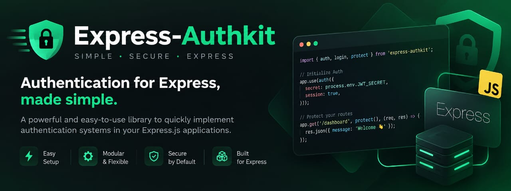

<p align="center">
  
</p>

# Express AuthKit

**Ajoutez une connexion par e-mail et mot de passe à votre API Express, en quelques lignes, sans sacrifier la sécurité.**

> Version 0.1.0 (candidate), pas encore publiée sur npm. Voir les [limites connues](docs/securite.md#limites-connues).

---

## En bref

Express AuthKit s'occupe pour vous de quatre choses :

1. **Stocker les mots de passe de façon sûre.** Vous ne gardez jamais le mot de passe, seulement une empreinte impossible à inverser.
2. **Connecter un utilisateur.** S'il donne le bon mot de passe, il reçoit un *token* (un jeton signé, comme un badge d'accès temporaire).
3. **Protéger vos routes.** Une route protégée refuse toute requête qui n'a pas de token valide.
4. **Contrôler les droits.** Une route peut être réservée à un rôle (« admin ») ou à des permissions précises.

Vous gardez votre base de données et votre modèle d'utilisateur. Vous écrivez seulement deux petites fonctions pour dire à la bibliothèque comment retrouver un utilisateur.

## Les mots à connaître

| Mot | En clair |
| --- | --- |
| **Hash** (empreinte) | Version brouillée du mot de passe, impossible à inverser. On stocke le hash, jamais le mot de passe. |
| **Token** (JWT) | Jeton signé remis après la connexion. Le client le renvoie à chaque requête pour prouver qui il est. Il expire après 15 minutes par défaut. |
| **Secret** | Longue chaîne aléatoire qui sert à signer les tokens. Elle doit rester secrète. |
| **Middleware** | Fonction Express qui s'exécute avant votre route, par exemple pour vérifier le token. |
| **Repository** | Petit objet qui sait retrouver un utilisateur dans **votre** base de données. |

## Prérequis

- **Node.js 22.12 ou plus récent** (la version 24 est recommandée).
- **Express 4.21+ ou 5.x**.
- Un projet en modules ES : `"type": "module"` dans `package.json`.

## Installation

```bash
npm install express-authkit express
```

> Tant que le package n'est pas publié sur npm, créez l'archive avec `npm pack` dans ce dépôt,
> puis installez-la dans votre projet : `npm install /chemin/vers/express-authkit-0.1.0.tgz express`.

## Démarrage en cinq minutes

**Étape 1 — Créez un projet**

```bash
mkdir mon-api && cd mon-api
npm init -y
npm pkg set type=module
npm install express-authkit express
```

**Étape 2 — Créez un secret**

Cette commande génère un secret aléatoire et l'enregistre dans un fichier `.env` :

```bash
echo "AUTH_SECRET=$(npx express-authkit secret)" > .env
```

Ne partagez jamais ce fichier et ne le mettez pas dans Git.

**Étape 3 — Créez `server.js`**

```javascript
import express from "express";
import { createAuthKit } from "express-authkit";
import { createExpressAuth } from "express-authkit/express";

// 1. Où trouver vos utilisateurs : ici une simple liste, pour la démonstration.
//    En production, interrogez votre base (voir docs/repository-utilisateur.md).
const users = [];
const userRepository = {
  findByIdentifier: async (email) => users.find((user) => user.email === email.toLowerCase()) ?? null,
  findById: async (id) => users.find((user) => user.id === id) ?? null
};

// 2. Le moteur d'authentification (la configuration est vérifiée immédiatement).
const auth = createAuthKit({
  users: userRepository,
  jwt: {
    secret: process.env.AUTH_SECRET,
    issuer: "my-api",
    audience: "my-client",
    expiresInSeconds: 900
  }
});
const expressAuth = createExpressAuth(auth);

// 3. Un utilisateur de démonstration (ne codez jamais de vrai mot de passe en dur).
users.push({
  id: "1",
  email: "alice@example.com",
  passwordHash: await auth.password.hash("example-password"),
  isActive: true
});

// 4. L'application : une route de connexion et une route protégée.
const app = express();

app.post("/login", express.json(), expressAuth.login({ identifierField: "email" }));

app.get("/profile", expressAuth.authenticate(), (req, res) => {
  res.json({ userId: req.auth.userId });
});

// 5. Des réponses JSON claires, en français, si le client envoie un JSON invalide.
app.use(expressAuth.errorHandler());

app.listen(3000, () => console.log("API sur http://localhost:3000"));
```

Ce que fait ce fichier, en cinq points :

1. **`userRepository`** explique à la bibliothèque comment trouver un utilisateur : par son e-mail (à la connexion) et par son identifiant (à chaque requête).
2. **`createAuthKit()`** crée le moteur. Si le secret manque ou est trop faible, l'application refuse de démarrer et vous explique pourquoi.
3. **`auth.password.hash()`** transforme le mot de passe en empreinte avant de l'enregistrer.
4. **`expressAuth.login()`** crée la route de connexion, et **`expressAuth.authenticate()`** protège `/profile`. Dans la route protégée, `req.auth.userId` contient l'identifiant de l'utilisateur connecté.
5. **`expressAuth.errorHandler()`** transforme les erreurs (JSON mal formé, par exemple) en réponses JSON claires, avec des messages en français.

**Étape 4 — Lancez et testez**

```bash
node --env-file=.env server.js
```

Dans un autre terminal :

```bash
# 1. Se connecter : la réponse contient "accessToken"
curl -s -X POST http://localhost:3000/login \
  -H "content-type: application/json" \
  -d '{"email":"alice@example.com","password":"example-password"}'

# 2. Sans token : refusé (401)
curl -i http://localhost:3000/profile

# 3. Avec le token (remplacez <accessToken>) : {"userId":"1"}
curl -s http://localhost:3000/profile -H "authorization: Bearer <accessToken>"
```

Ça marche ? Votre API a maintenant une connexion sécurisée. 🎉

Une application plus complète, avec ses tests, se trouve dans [examples/basic-express](examples/basic-express).

## L'essentiel en un coup d'œil

| Je veux… | Code |
| --- | --- |
| Créer le moteur | `const auth = createAuthKit({ users, jwt: { secret, issuer, audience } })` |
| Le brancher sur Express | `const expressAuth = createExpressAuth(auth)` |
| Ajouter la route de connexion | `app.post("/login", express.json(), expressAuth.login())` |
| Protéger une route | `app.get("/me", expressAuth.authenticate(), handler)` puis `req.auth.userId` |
| Réserver une route à un rôle | `app.get("/admin", expressAuth.authorize("admin"), handler)` |
| Hacher un mot de passe (inscription) | `await auth.password.hash(password)` |
| Vérifier un mot de passe | `await auth.password.verify(password, hash)` |
| Rester connecté plus de 15 minutes | `refreshTokens: { store }` puis `app.post("/auth/refresh", express.json(), expressAuth.refresh())` |
| Déconnecter | `app.post("/auth/logout", express.json(), expressAuth.logout())` |
| Générer un secret | `npx express-authkit secret` |

**Votre repository** : deux fonctions, `findByIdentifier()` et `findById()`. Elles renvoient
`{ id, passwordHash, isActive }`, ou `null` si l'utilisateur n'existe pas.
`id` peut être un texte, un nombre ou un `ObjectId` MongoDB.

## Avant de passer en production

- [ ] Limitez le nombre de tentatives de connexion ([exemple prêt à copier](docs/securite.md#limitation-des-tentatives-de-connexion)).
- [ ] Servez l'API uniquement en **HTTPS**.
- [ ] Gardez le secret hors du code, dans une variable d'environnement.

La liste complète se trouve dans le [guide de sécurité](docs/securite.md).

## Documentation

**Pour démarrer**

- [Brancher ma base de données](docs/repository-utilisateur.md) (PostgreSQL, Prisma, MongoDB…)
- [Connecter les utilisateurs et protéger les routes](docs/connexion-et-routes.md)
- [Gérer les mots de passe](docs/mots-de-passe.md) (inscription, changement de mot de passe)
- [Rôles et permissions](docs/roles-et-permissions.md) (réserver une route aux administrateurs…)
- [Rester connecté : les refresh tokens](docs/refresh-tokens.md) (et la déconnexion)
- [Utiliser TypeScript](docs/typescript.md) (autocomplétion, `req.auth` typé)
- [Régler la configuration](docs/configuration.md)

**Quand quelque chose ne va pas**

- [Dépannage](docs/depannage.md)
- [Comprendre les erreurs](docs/erreurs.md)

**Pour aller plus loin**

- [Sécurité : bonnes pratiques et limites](docs/securite.md)
- [Référence complète de l'API](docs/reference-api.md)
- [Remplacer le hachage ou les tokens](docs/providers-personnalises.md)
- [Architecture du projet](docs/architecture.md)

**Le projet** : [contribuer](CONTRIBUTING.md) · [historique des versions](CHANGELOG.md) · [signaler une faille](SECURITY.md)

## Ce que la version 0.1.0 ne fait pas (encore)

Pas de connexion via Google/GitHub (OAuth), pas de double authentification (MFA), pas de
hiérarchie de rôles ni de droits par objet (ACL), pas de cookies `HttpOnly`, pas de réinitialisation de mot de passe
par e-mail.
Ces sujets sont [prévus pour plus tard](docs/architecture.md#points-dextension-futurs).

## Licence

[MIT](LICENSE)
